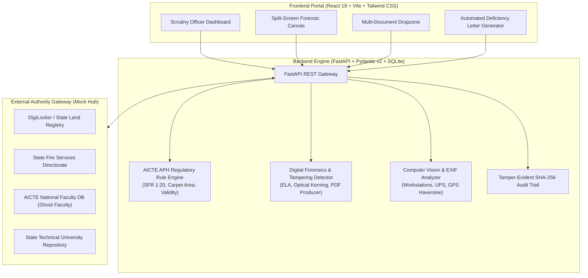

# AICTE AI-Powered Application Validation, Document Authentication & Regulatory Compliance Engine

**Smart India Hackathon (Problem Statement ID: 26261)**  
*Organization:* All India Council for Technical Education (AICTE), Ministry of Education, Govt. of India  
*Theme:* Smart Automation, Digital Forensics, Regulatory Intelligence & Fraud Prevention

---

## 📌 Executive Summary

Every year, AICTE scrutinizes over 10,000+ technical institutions across India seeking Extension of Approval (EoA) or new program sanctions. Manual verification of statutory documents, faculty rosters, building plans, and fire clearances is labor-intensive, error-prone, and susceptible to fraudulent manipulations (such as intake alterations, forged university seals, and "ghost faculty" listed concurrently across multiple colleges).

This prototype delivers an **end-to-end, AI-powered scrutiny and compliance verification platform** that automates the entire validation workflow against the **AICTE Approval Process Handbook (APH) 2025-26** norms.

---

## 🏗️ Architecture & Tech Stack



### Technology Highlights
- **Backend**: Python 3.10+ with FastAPI, Pydantic v2, and SQLite repository.
- **Frontend**: React 18, Vite, Tailwind CSS, and Lucide Icons.
- **Embedded Web GUI**: Zero-friction single-page application served directly by FastAPI at `http://localhost:8000/`.
- **Explainable AI (XAI)**: Visual bounding boxes `[x, y, width, height]` with confidence ratings and forensic reasoning.
- **Cryptographic Audit Ledger**: SHA-256 hash chaining of every ingestion, scrutiny check, and officer decision.

---

## ⚡ Core Features Implemented

### 1. Feature A: Institution Submission & Multi-Document Dropzone
- Institution data: AICTE Permanent ID, Category (Engineering/Management/Pharmacy/Polytechnic), Sanctioned Intake, Declared Faculty, Built-up Area (sqm), and Campus Geolocation.
- Supports 5 mandatory regulatory categories:
  1. Land Ownership Affidavit / Revenue Title Deed
  2. State Fire Safety NOC Certificate
  3. Affiliating University NOC / Affiliation Order
  4. Certified Faculty Roster with PAN/Aadhaar references
  5. Infrastructure Photographs (Computer Center, Classroom, Labs) with camera EXIF tags.

### 2. Feature B: Intelligent Document Extraction & Cross-Record Validator
- **Document Classifier**: Identifies document category using keyword vector matching and layout recognition.
- **Field Extractor**: Extracts issuing authorities, document reference numbers, issue/expiry dates, and approved intake.
- **Cross-Verification Engine**:
  - Compares declared faculty against verified uploaded roster (flags deficits).
  - Evaluates Student-to-Faculty Ratio (SFR) based on category:
    - **Engineering (UG)**: 1:20
    - **Management (MBA)**: 1:15
    - **Pharmacy**: 1:15
    - **Polytechnic (Diploma)**: 1:25
  - Computes minimum instructional carpet area requirements per student (e.g. 4.5 sqm/student).

### 3. Feature C: Document Forgery & Digital Tampering Detection (Explainable AI)
- **Metadata Forensics**: Flags documents produced or modified by third-party editing tools (Canva, Photoshop, Foxit, GIMP).
- **Font & Kerning Discrepancy**: Detects altered intake numbers (e.g., intake modified from 120 to 240 or 60 to 180) via baseline shifts, font weight variations, and Error Level Analysis (ELA).
- **Interactive Visual Tagging**: Highlights exact bounding boxes on the document canvas with confidence scores and explanation tooltips.

### 4. Feature D: External Issuing Authority Verification Gateway (Mock Hub)
Simulates real-time API integrations with:
- **DigiLocker / State Land Registry**: Validates digital land deed authenticity and encumbrance status.
- **State Fire Service Directorate**: Verifies Fire NOC reference numbers and expiry dates against municipal records.
- **AICTE National Faculty Database (NFDB)**: Cross-references faculty PAN/Aadhaar to detect **"Ghost Faculty"** teaching at multiple institutions concurrently.
- **State Technical University Portal**: Validates sanctioned branch intake against official syndicate orders.

### 5. Feature E: Computer Vision Infrastructure Evidence Analyzer
- **Workstation Counting**: Detects computer terminals and monitors in laboratory photos.
- **Safety Equipment Detection**: Validates presence of dedicated UPS racks and automatic fire suppression (FM200 / extinguishers).
- **EXIF Geotag Verification**: Extracts embedded camera GPS coordinates and calculates Haversine distance offset against the declared campus location (flags missing EXIF or stock photos).

### 6. Feature F: AICTE Scrutiny Officer Decision Dashboard
- **Status Matrix**: High-level overview of all institutions categorized into 4 compliance tiers.
- **Split-Screen Scrutiny Viewer**: Left panel interactive document viewer with bounding boxes; Right panel regulatory checklist, external logs, and action panel.
- **Decision Support Actions**:
  - `Approve EoA Application`
  - `Issue Automated Deficiency Notice` (generates formal AICTE letter citing APH clauses with a 15-day compliance window)
  - `Escalate for Surprise Physical Inspection` (assigns Standing Hearing Committee / EVC squad).
- **Tamper-Evident Audit Trail**: Immutable log with SHA-256 block hash chaining.

---

## 🧪 Pre-Configured Synthetic Test Cases (For Jury Demo)

| Test ID | Institution Name | Category | Sanctioned Intake | Declared Faculty | Regulatory Status | Key AI Findings |
|---|---|---|---|---|---|---|
| **TC-01** | **Apex Institute of Technology** | Engineering | 720 | 38 | 🟢 **COMPLIANT** | Valid Fire NOC (till Nov 2027), DigiLocker verified deed, surplus SFR (1:18.9 vs 1:20), 180 networked lab PCs with UPS, authentic EXIF geotag (0.02 km offset). |
| **TC-02** | **Sunrise College of Engineering** | Engineering | 1200 | 60 | 🟡 **DEFICIENCY NOTICE REQUIRED** | Fire NOC expired on 15-Jan-2025; Cross-record check verified only 48 faculty vs 60 declared (Deficit of 12 faculty; SFR 1:25). |
| **TC-03** | **Global Institute of Management** | Management | 240 | 16 | 🔴 **SUSPECTED TAMPERING** | AKTU Affiliation Letter altered via Canva from 120 to 240 seats (optical kerning mismatch, baseline shift); 2 duplicate "Ghost Faculty" detected concurrently active in another institute in Gurugram. |
| **TC-04** | **Greenfield Polytechnic** | Polytechnic | 960 | 40 | 🟠 **PHYSICAL INSPECTION REC.** | Computer lab photo is a commercial stock photo (Shutterstock reverse hash, zero camera EXIF GPS data); Carpet area deficit of 1,800 sqm (30% below AICTE minimum). |

---

## 🚀 Quick Start Guide

### Option 1: Zero-Friction 1-Click Launch (Recommended)

#### On Windows (PowerShell):
```powershell
# Open terminal in project root
.\run_backend.ps1
```

#### On Windows (Command Prompt):
```cmd
run_backend.bat
```

#### Manual Python Execution:
```bash
python -m uvicorn backend.main:app --host 127.0.0.1 --port 8000 --reload
```

Once running:
- **Interactive Web Portal**: Open [http://localhost:8000/](http://localhost:8000/) in your browser.
- **Interactive OpenAPI Documentation**: Open [http://localhost:8000/docs](http://localhost:8000/docs).

---

### Option 2: Running the React + Vite Frontend (Dev Server)

If you have Node.js installed and wish to run Vite independently:
```bash
cd frontend
npm install
npm run dev
```
The Vite development server will start at `http://localhost:5173/` and automatically proxy `/api` calls to FastAPI on `http://127.0.0.1:8000`.

---

## 📋 REST API Endpoints Reference

| Method | Endpoint | Description |
|---|---|---|
| `GET` | `/api/health` | Health check & system status. |
| `GET` | `/api/stats` | KPI metrics (total, compliant, deficient, tampered, inspection). |
| `GET` | `/api/institutions` | List all institutional applications. |
| `GET` | `/api/institutions/{id}` | Full institutional scrutiny payload (documents, anomalies, external verifications, checklist, audit log). |
| `POST` | `/api/institutions` | Submit a new institutional application. |
| `POST` | `/api/institutions/{id}/upload-document` | Upload document, run OCR, auto-classify, run digital forensics, and attach bounding boxes. |
| `POST` | `/api/institutions/{id}/evaluate` | Trigger AICTE APH rule engine evaluation. |
| `POST` | `/api/institutions/{id}/external-verify` | Query mock hub gateways (DigiLocker, State Fire, AICTE NFDB). |
| `POST` | `/api/institutions/{id}/decision` | Record scrutiny officer decision with remarks. |
| `GET` | `/api/institutions/{id}/deficiency-notice` | Generate formal AICTE Deficiency Notice citing APH clauses. |
| `POST` | `/api/institutions/reset-demo` | Reseed SQLite database with the 4 default test cases. |

---

## 🎓 Smart India Hackathon Demo Script (3-Minute Walkthrough)

1. **Dashboard Overview (30s)**:
   - Point out the 5 KPI metric cards at the top showing institutional distribution.
   - Explain the filterable table showcasing AICTE Permanent IDs, Sanctioned Intake, Declared Faculty, Risk Scores, and Compliance Badges.

2. **Scenario 1: Full Compliance (TC-01 Apex Institute) (30s)**:
   - Click **TC-01 Apex Institute**.
   - Show how all 5 mandatory documents are green, DigiLocker QR is authenticated, and the EXIF geotag accurately matches the Bangalore campus with 180 workstations detected.
   - Click **Approve EoA Application**.

3. **Scenario 2: Deficiency Notice (TC-02 Sunrise College) (45s)**:
   - Click **TC-02 Sunrise College**.
   - Notice the amber badge: Fire NOC expired on 15-Jan-2025 and SFR is 1:25 with a deficit of 12 faculty.
   - Click **Issue Deficiency Notice** to open the formal AICTE letter citing Clause 7.1 and 5.1 with a 15-day compliance window.

4. **Scenario 3: Digital Forgery & Ghost Faculty (TC-03 Global Institute) (45s)**:
   - Click **TC-03 Global Institute**.
   - Inspect the **Split-Screen Scrutiny Viewer**: Click on the red bounding box over the sanctioned intake "240" in the AKTU affiliation letter to reveal the Error Level Analysis (ELA) and Canva editing software signature.
   - Switch to the **External Gateway** tab to show the 2 duplicate "Ghost Faculty" members identified simultaneously teaching in Gurugram.
   - Click **Escalate Surprise Inspection**.

5. **Scenario 4: Stock Infrastructure Photo (TC-04 Greenfield Polytechnic) (30s)**:
   - Click **TC-04 Greenfield Polytechnic**.
   - Show how the Computer Vision inspector flagged the computer lab photo as a commercial stock image with stripped EXIF and zero GPS tags, alongside an instructional carpet area deficit of 1,800 sqm.

---

## 🛡️ License & Regulatory Compliance
Developed for the **Smart India Hackathon (SIH)**.  
Conforms to statutory guidelines of the **AICTE Approval Process Handbook (APH) 2025-26** and the **AICTE Act 1987**.
